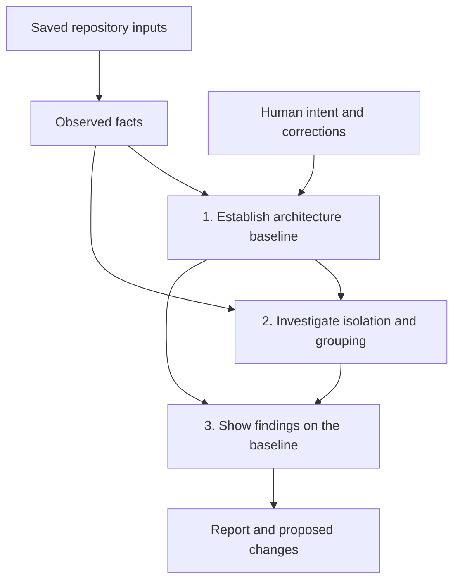

# LLM-led architecture analysis

Status: **Proposed — design only**

Updated: **2026-11-08**

This document defines Choom's analysis process, tools, saved data, and outputs.

## Contents

- [Goal: let systems evolve through constraints and replacement](#goal-let-systems-evolve-through-constraints-and-replacement)
- [Three steps](#three-steps)
- [Step 1: establish the architecture baseline](#step-1-establish-the-architecture-baseline)
  - [Model and review](#model-and-review)
  - [Map components to code](#map-components-to-code)
- [Step 2: investigate isolation and granularity](#step-2-investigate-isolation-and-granularity)
  - [Starting smell catalog](#starting-smell-catalog)
  - [Tools and algorithms](#tools-and-algorithms)
  - [Investigation and recommendations](#investigation-and-recommendations)
- [Step 3: show findings on the baseline](#step-3-show-findings-on-the-baseline)
  - [Proposals and the component diff](#proposals-and-the-component-diff)
  - [Report views](#report-views)
- [Runs and saved evidence](#runs-and-saved-evidence)
  - [Saved records](#saved-records)
- [Three analysis modes](#three-analysis-modes)
- [Compatibility](#compatibility)
- [Evaluation](#evaluation)
- [Research basis](#research-basis)
- [Appendix A: No baseline for a Node and TypeScript repository](#appendix-a-no-baseline-for-a-node-and-typescript-repository)
  - [End result: architecture discovery files](#end-result-architecture-discovery-files)
  - [Recovery process](#recovery-process)

## Goal: let systems evolve through constraints and replacement

Software engineering exists to solve real problems. Production software gives
us feedback about what works, what fails, and what people need. We use that
feedback to learn and change the system.

Choom's goal is to keep the whole system able to evolve as we learn. AI coding
agents change the cost and pace of that process:

- Agents produce code faster than people can review line by line. Without checks, structural
  problems can accumulate just as quickly.
- Agents make replacement code cheap to produce. Discarding a whole implementation
  can become more practical than repairing it piece by piece.

Choom accepts that code will be imperfect and can deteriorate or become outdated
as our understanding improves. As code becomes cheaper to produce, preserving the
system's ability to evolve matters more than preserving each implementation.
Choom aims to make each component cheap to replace when new learning calls for it.

Choom focuses on a limited set of constraints: component boundaries, interfaces,
ownership, and allowed dependencies. Agents build and change code within them.
Choom checks where these constraints fail or need to change. People review the
constraints and supply business intent.

The expected cycle is to create a component, use it in production, learn from
the feedback, and adapt or replace its implementation. Contracts, constraints,
and recorded decisions preserve what we learned. With the external contract
unchanged, replacement should leave outside code and tests unchanged.

The mental model is urban planning. The planner defines zones, connections, and
rules at their boundaries. Builders construct and replace individual buildings.
The city keeps working as buildings age and are rebuilt. Its plan can also change
deliberately as needs change. Choom takes the planner's role; coding agents do the
construction and replacement.

A component is a unit that owns behavior and implementation decisions. It can
also own state. It can cover several files or part of one file. It need not be a
class, package, process, or service. Its contract includes behavior, data, errors,
state access, and setup and cleanup rules, as well as function signatures.

Choom checks two separate properties:

| Property | Question |
| --- | --- |
| Isolation | Can we replace the implementation while keeping its contract, without changing outside production code or tests? |
| Granularity, or component grouping | Does the grouping force unrelated behavior to be understood, changed, or replaced together? Does it spread one decision across several components? |

A large component can have good isolation but still be too costly to replace.
Many small components can force changes across several boundaries. A recommendation
must explain the benefit of a new grouping and the cost of its added interfaces.
Keeping the current grouping is always an option.

Code size, function length, and a count of "responsibilities" do not decide these
questions. Choom identifies specific obstacles to change. It does not certify
future replacements or provide runtime fault containment.

The first supported source profile is TypeScript, JavaScript, TSX, and JSX.
The analysis does not require Git, Choom manifests, a successful build, or an
analyzer installed in the target repository.
Other languages and unsupported behavior remain visible as analysis gaps.
Choom does not edit application code during analysis.

## Three steps



A **snapshot** is the fixed set of saved inputs for one assessment. A **baseline**
is the intended architecture selected for that assessment. It can include both
inferred expectations and rules that the project has accepted.

Keep these records separate:

| Record | Meaning |
| --- | --- |
| Observed facts | What a tool found in the snapshot, within the limits of that tool and query. |
| Baseline | Intended components, interfaces, ownership, and rules. |
| Proposals | Possible changes to the baseline, with reasons and required work. |

All three steps use the same saved inputs and share evidence. One LLM investigator
can run the process. It asks questions and interprets results. Deterministic tools
collect evidence, check supported rules, and compare models.

## Step 1: establish the architecture baseline

**Question:** What architecture does the project appear to intend, and which code
belongs to each component?

Tools collect source relationships. The LLM uses those facts, documents, and
representative behavior paths to describe intended components, interfaces, and
state ownership. Record conflicts between code and documents. Folders, exports,
and existing dependencies do not by themselves define intended boundaries or
allowed access. Leave boundary improvements and smell findings to Step 2.

Use an existing baseline and identify code it does not cover. Add provisional
items for that code without weakening accepted rules. If no baseline exists,
follow [Appendix A](#appendix-a-no-baseline-for-a-node-and-typescript-repository).
Label all inferred intent as provisional.

### Model and review

Use one model format for baselines and proposals:

| Item | Contents |
| --- | --- |
| Component (`components`) | Name, purpose, reason for the grouping, optional parent, and membership rules based on paths or symbols. |
| Interface (`interfaces`) | Name, owner, public access points, allowed consumers, and known behavior, data, error, and lifecycle promises. |
| Resource (`resources`) | Name, state or external resource, intended owner, and rules for access and updates. |
| Rule (`rules`) | Subject, expected condition, and a supported check when one exists. |

Each item has an ID. Each statement records its source and whether it is proposed
or accepted. Acceptance follows the project's policy and can cover selected
statements. New or changed statements remain proposed until accepted. An LLM
cannot accept its own proposal.

A human can correct the model or add business intent. For example: "Customer
pricing must change independently of invoicing." Once a baseline is saved,
accepting or correcting its statements creates a new version and assessment.
Earlier reports keep the versions they used. Human review is optional; Choom
can continue with a provisional baseline.

The baseline stores membership rules and intended ownership. The run stores the
code matched by those rules and the observed resource access. Keep these results
out of the reusable baseline. A missing or ambiguous match stays unresolved.
Do not silently guess which new symbol replaces an old one.

### Map components to code

A code unit is a file or a recorded part of a file. Start with files. Divide a
file only when a boundary inside it needs examination.

- Each unit has one direct owner or an unknown owner.
- A division must cover all code, including module setup and leftover statements,
  without overlap. Use the syntax tree to record the parts. Keep the file as one
  unit until that map is complete.
- Parents group components without owning their code twice. A component cannot
  contain itself, directly or indirectly. A parent does not automatically add an
  isolation boundary. Dependency cycles are a separate issue.
- Keep references to unknown owners. When a dependency cannot be assigned to a
  part of a file, keep it unresolved rather than dropping or duplicating it.

An exact ownership comparison needs matching code-unit maps. Unknown dependencies
limit conclusions about isolation, but do not invalidate a known ownership change.

**Output:** the baseline diagram and model, its mapping to code, sources and
acceptance status, uncovered code, and questions about intent. Appendix A defines
the [structured output](#end-result-architecture-discovery-files).

## Step 2: investigate isolation and granularity

Ask both questions:

- **Isolation:** What change behind the current contract would force outside changes?
- **Granularity:** What grouping forces unrelated behavior to be handled together,
  or forces one change across several components?

Tools identify places to inspect. The LLM can also investigate a concern found
in source or documents. A detector result starts an investigation; it does not
establish a defect.

### Starting smell catalog

These seven families are investigation prompts. Several can describe one problem.
They do not limit Choom to known categories. See the [research basis](#research-basis).

| Family | Starting evidence | Required explanation |
| --- | --- | --- |
| Implementation details escape | Private imports, exposed storage types, callers decoding internal formats, outside tests using internals. | Which decision escaped, who depends on it, and whether that exposure is intentional. |
| Shared state or hidden ordering | Multiple writers, shared mutable objects, global state, setup effects, required call order. | Who owns the state and its rules, and how a change can affect another component. |
| Independent behavior is bundled | Separate clients, exports, state, dependencies, or change histories. | What can usefully change or be replaced separately, and why a split is worth its cost. |
| One decision is scattered | Repeated rules or encoding logic, repeated changes across components. | Which decision needs one owner; similar code alone is insufficient. |
| Components depend on each other in a cycle | A directed cycle at a stated graph level. | How the cycle obstructs change or testing, and which dependencies cause the problem. |
| A central component connects unrelated decisions | Many incoming and outgoing dependencies plus knowledge of other implementations. | How it spreads changes; shared utilities and intentional coordination can be valid. |
| Interfaces hide too little | Pass-through calls, internal options exposed to callers, callers coordinating internal steps. | What callers still need to know, and whether a better interface or fewer fragments would help. |

### Tools and algorithms

Reuse the [source and reference tools in Appendix A](#appendix-a-no-baseline-for-a-node-and-typescript-repository).
Add these analyses when a question needs them:

| Tool | Result | Main limit |
| --- | --- | --- |
| Tarjan's strongly connected components algorithm, then path search | Groups whose nodes can reach each other, followed by actual cycle paths. | A group is not itself a cycle path. State whether nodes are files, symbols, or components. |
| Set and graph queries | Incoming/outgoing dependencies, edges across a proposed boundary, and consumer groups for exports. | Counts and consumer overlap suggest questions, not correct ownership. |
| [Git log and diff](https://git-scm.com/docs/git-log), when available | Commits, files changed together, counts, and change rates. | Commit habits can look like architectural coupling. |
| Choom rule checks | Pass, violation with evidence, or not checked. | A check covers only the rules and source forms it supports. |

Each graph query states its scope, dependency kinds, and project settings.
A graph that combines several configurations shows their possible dependencies;
it does not prove that those dependencies occur together at runtime.
State when a finding depends on suspected-unused or unassessed code.

Imports do not capture all coupling. Use syntax queries and source reads to
inspect shared objects, SQL or ORM access, file paths, and message channels.
Record each access site, operation, name or path expression, and known runtime
context. Two matching table or event names need not refer to the same instance.
Keep inferred resource identity and ownership distinct from observed access
syntax. Leave dynamic names and missing paths unresolved.

For a proposed boundary, list crossing edges, their direction, source locations,
shared dependencies, and unknown targets. Compare export groups by their consumer
sets; empty sets do not establish independent use. For history, keep individual
and joint change counts, and how often A changes when B changes in each direction.
Record the commit range and treatment of renames, merges, and bulk edits.

A component cycle can exist without a file cycle. For example, `a1(A) -> b1(B)`
and `b2(B) -> a2(A)` produce `A <-> B` without a closed file path. Retain evidence
for each component edge and make no stronger claim than the selected graph supports.

Graph clustering is optional. It can suggest groups when the LLM needs help.
Record the algorithm, graph, weights, settings, and random seed. The resulting
groups still need a reason to exist as software components.

### Investigation and recommendations

For each possible problem, the LLM:

1. States a specific change or replacement scenario.
2. Reads the implementation, callers, contract, and relevant tests.
3. Requests focused evidence from the tools.
4. Looks for reasons to keep the design, such as a shared consistency rule,
   transaction, lifecycle, protocol, or useful adapter.
5. Records a finding, a rejected concern with its reason, or an open question.

Compare keeping the boundary with repairing an interface, splitting, combining,
or moving behavior. A split must name its members, state owners, interface, and
known crossing dependencies. Explain what becomes easier to change or replace,
and weigh that benefit against added coordination and interfaces. List unknowns.

For example, Reporting can have a clean public interface but combine PDF rendering
and email delivery. A split helps only if it makes a relevant change or replacement
smaller without creating more costly coordination. Separate clients alone do not
justify separate components.

Separate the one-time boundary repair from later replacement. A repair can
require changes to callers, tests, stored data, or setup. List that work and the
contract it would establish. Then explain how a later replacement could preserve
that contract and leave outside code and tests unchanged. A planned repair does
not prove current isolation. A deliberate public-contract change is not itself
an isolation failure.

**Output:** findings with evidence and opposing evidence, rejected concerns, open
questions, and local recommendations. A full new architecture is optional.

## Step 3: show findings on the baseline

Tools map evidence to components, check rule applicability, and compute model
differences. The LLM explains the consequences and suggests a response.

| Finding kind | Meaning | Example |
| --- | --- | --- |
| Baseline mismatch | Code conflicts with a baseline expectation. | Checkout directly accesses Billing's private storage. |
| Boundary problem | Isolation or grouping needs attention, even if the code follows the baseline. | Replacing email delivery also requires preserving unrelated PDF behavior. |

Keep open questions visible beside findings. Do not count them as confirmed defects.
Link findings that describe the same problem; do not multiply counts for smell labels.

A finding records:

- Its ID, kind, and affected components, code, interfaces, and resources.
- The change scenario, consequence, baseline version, and relevant rules.
- Evidence links, opposing evidence, assumptions, and gaps.
- A suggested action and the work it requires.

State whether the conclusion was checked or inferred.
A serious possible problem can still have weak evidence.

A **confirmed rule violation** needs evidence that a deterministic check can verify.
Every baseline statement the check relies on must be accepted and apply to the
source without ambiguity. This includes the rule and any ownership or interface
definitions it uses. Otherwise report a possible mismatch. Valid source links
alone do not confirm an LLM interpretation.

One observed forbidden import can establish a violation despite gaps elsewhere.
A passing result needs enough coverage to check that rule across its stated scope.
Unsupported checks report "not checked."

### Proposals and the component diff

A local before/after proposal is enough for many findings. It names its scope and
explicit changes; all other baseline items stay unchanged. When a proposal has
precise membership, compare it with the baseline as follows:

1. Map both models to the same saved source, scope, and code-unit map. Use the
   baseline mapped for this run, not assignments saved for an older snapshot.
   For a split inside a file, apply the same complete division to both models.
2. Compare components, interfaces, resources, and rules. List added/removed items,
   changed fields, and old/new owners for affected code. Keep IDs for continuing
   components. Record each ownership change once.
3. Group the same observed dependencies by the proposed owners. Keep required
   code changes separate from those observations.
4. Check ownership, references, and parent relationships. Verify that the listed
   changes fully account for the difference between the saved models.

Split, combine, move, rename, and reparent are summaries of that comparison.
An incomplete code-unit map can block a precise diff without blocking a useful
recommendation. Keep competing proposals separate; combine only compatible ones.
The comparison does not edit code or change the baseline used to judge it.
Changing an accepted rule does not mean the old implementation was repaired.

### Report views

- **Baseline:** components, contracts, code membership, proposed/accepted status,
  and gaps. Keep deferred regions visible with their status and reason; they can
  be collapsed in the diagram. A human can submit corrections from this view.
- **Findings:** affected components and observed crossings. Open a finding to see
  its consequence, rule, captured source, tool results, and limits.
- **Proposals:** before/after grouping or contract changes, linked findings,
  benefits, required work, and alternatives. Viewing a proposal does not accept it.

Keep observed dependencies distinct from intended access rules in every view.
Provide the same records as a structured report. Diagram positions are display
settings. An unflagged component is not certified healthy. Portable export of all
source evidence is outside this design.

## Runs and saved evidence

The workflow controls the investigator, tool requests, limits, and run state.
Tool adapters collect facts. Deterministic checks validate model references,
source mappings, rule results, and differences. The LLM interprets evidence; it
cannot create tool results or declare tool coverage complete.
Repository text cannot change tool permissions or authorize actions.

Capture the target source first. Step 1 can draft or extend a baseline while
using facts from that snapshot. Save the selected baseline version before
Steps 2 and 3 assess it. Each report identifies that target snapshot and baseline;
change reports also identify the older snapshot used for comparison.

Later queries add evidence records; they do not change records already referenced
by the saved discovery result. Investigation findings can cite the added evidence.
A change to the snapshot or saved baseline starts a new assessment. A baseline
correction can reuse unchanged tool facts, but needs updated mappings and affected
findings. Earlier absence claims do not carry over automatically. If an investigation
needs uncaptured files, capture a new snapshot before using them.

Save the selected source, documents, configuration, and required analysis inputs.
Record paths, contents, digests, exclusions, and how the copy was made. Retry
observed concurrent edits or report the capture limit. Copying files does not
prove they all existed together at one instant.

Tools use these saved inputs or the recorded toolchain. Missing inputs stay
unresolved; tools must not quietly read the live checkout or other directories.
Attempts can share one verified, read-only tool input for the same inventory.
Keep each attempt's settings, verification receipts, and results separate. Check
the shared input before use; do not copy the repository again for each retry.
Enforce these file-access limits. The pinned dependency-cruiser reads the real
filesystem; a temporary copy or working-directory setting does not contain its
reads. Run it in a restricted filesystem view, or report that analysis unsupported.
Save rule definitions and supporting inputs separately from the code under review,
so changed code cannot weaken its own checks.

Use Choom-owned static configuration and supported data-only project settings.
This source-analysis profile does not run target builds, tests, plugins, or
executable analyzer configuration. Reading a test does not show that it passes.
Runtime experiments would need an environment that enforces file and network
access limits.

### Saved records

Versioned local directories are sufficient. Keep completed records unchanged.
Preserve questions and gaps with linked resolution notes. Refresh summaries and
limits in each new unpublished proposal so they describe its current records.
Do not carry an obsolete count or pending-stage claim into a current explanation.

| Record | Contents |
| --- | --- |
| Baseline version | `baseline.yaml`: architectural items, membership rules, statement sources and acceptance decisions, parent version, and IDs. |
| Run manifest | Format version, run ID, analysis mode, snapshot/baseline IDs and digests, artifact references, scope and coverage, tool/model versions, limits, times, and outcome. |
| Inputs and tool evidence | Saved files, resolution inputs, selected Git evidence, raw results, and tool-call records. |
| Code mapping and facts | Code units and owners, file roles, project settings, entry candidates and their sources, Knip reports, reachability with its roots and method, dependencies with kinds and contexts, symbol results, and observed resource access. |
| Discovery result | `discovery.yaml`: baseline and fact references, system explanation, inspected paths, questions, and gaps, including deferred regions and reasons. |
| Investigation report | Findings, rejected concerns, open questions, evidence links, proposals, and model comparisons from Steps 2 and 3. |
| LLM audit record | Prompt version, model settings, supplied context, and saved responses under the project's data policy. |

Each tool-call record includes its inputs, operation/version, query scope, limits,
result, and output digests. State what was examined, excluded, unsupported,
unresolved, or cut short. A query with no matches still needs its searched scope.
Partial results cannot establish that something is absent.

Source links include the snapshot, file digest, and range. Reopen saved source.
Validate the report format and check the digests of saved evidence. Show missing
or mismatched evidence as unavailable. Apply project exclusions before saving
inputs or sending model context. Do not collect credentials or
environment dumps as analysis inputs. Record omitted evidence and its effect on
inspection. Source transmission follows the selected provider and data policy;
local storage does not imply that model requests stay local. Do not save hidden reasoning.

Validate a report and finish its analysis tasks before publishing it as one
complete update. Cancellation that takes effect before publication prevents it.
After publication, report that the run completed. Failed or cancelled work keeps
the last published report. Block conflicting work until task cleanup is confirmed.

Keep three states separate: whether execution completed, what the analysis
covered, and which evidence is still available. A completed report can have gaps.
Removed evidence does not resolve an old finding. Reopening needs no model call;
repeating a model request is a new analysis, not an exact replay.
The manual Appendix A profile permits separate, dated run notes for a minor
explanatory correction. They identify the original record and digest, the exact
field, corrected explanation and evidence. They do not replace selected facts or
change validator results. See [record a correction](app-a/start-here.md#record-a-correction)
for the supported route; completed Stage 5 records and fixed results cannot be
reopened by the current helpers.

## Three analysis modes

The modes choose the starting scope. They use the same three steps.

| Mode | Baseline | Scope and result |
| --- | --- | --- |
| A: unfamiliar repository | Recover a provisional baseline or use existing project guidance. | Examine supported source; report the baseline, findings, proposals, and gaps. |
| B: new or unexamined area | Keep accepted rules; add provisional items for new code in a new baseline version. | Include its callers, dependencies, tests, and shared resources; report affected findings and model changes. |
| C: routine changes | Reuse the selected baseline, even if provisional. Check accepted rules when available. | Compare old/new facts and reassess affected findings. Keep inferred expectations distinct from accepted rules. |

Use both old and new dependencies to assess impact. New callers, writers, exports,
or settings can affect unchanged code. An earlier "no outside callers" result
also depends on the scope searched. Revisit deferred code when entry sets change.

Reuse saved Choom tool facts only when their inputs, settings, and tool versions
match. Reassess LLM conclusions unless their continued validity is established.
Unchanged cited lines or signatures are insufficient. Widen the analysis or
report the limit when impact is uncertain.

Mark findings introduced or resolved only when rules, coverage, and checks are
comparable. First detected does not mean newly introduced. Lost coverage means
not checked again, not resolved. Keep source changes separate from proposed
architecture changes on the same snapshot.

## Compatibility

Keep existing Load Repo and version-1 diagram import/export behavior. Analysis
records use a separate format. The current
[document builder](../../src/domain/build-architecture-document.ts) drops internal
component imports, so this analysis must retain facts before that step. The current
ts-morph script provides counts, not the proposed queries. No application LLM
workflow or general execution sandbox is assumed to exist.

## Evaluation

Check data validity separately from analysis quality. Data checks cover source
links, ownership, graph paths, rule inputs, and model comparisons. Review analysis
quality on repositories kept separate from prompt development. Include:

- A real leak and a legitimate shared contract.
- A useful split and a case where shared state or coordination makes a split worse.
- Unnecessary fragments and a useful thin adapter.
- Missing coverage and a violation that can still be confirmed.
- A missed worker entry and code reached only from tests.

Allow several reasonable component groupings. Measure correct findings and false
alarms, missed problems, useful proposals, variation across runs, coverage, time,
and cost. A report with only unknowns is insufficient when usable evidence exists.
The seven-family catalog is a starting hypothesis. An 80% claim needs independently
identified problems and room for cases outside the catalog.

## Research basis

These sources inform the design. They do not validate Choom or prove detector coverage.

- Parnas, [On the Criteria To Be Used in Decomposing Systems into Modules](https://doi.org/10.1145/361598.361623)
  (1972): ownership of changeable implementation knowledge.
- Fowler and Beck, [Refactoring, chapter 3](https://www.informit.com/content/images/9780201485677/samplepages/9780201485677.pdf)
  (1999), and [the second edition](https://www.informit.com/store/refactoring-improving-the-design-of-existing-code-9780134757711)
  (2018): divergent change, shotgun surgery, intimacy, and mutable data.
- Suryanarayana, Samarthyam, and Sharma,
  [Refactoring for Software Design Smells](https://www.oreilly.com/library/view/refactoring-for-software/9780128013977/XHTML/B9780128013977000059/B9780128013977000059.xhtml)
  (2014): modularization and encapsulation smells.
- Ousterhout, [A Philosophy of Software Design](https://web.stanford.edu/~ouster/cgi-bin/book.php)
  (second edition, 2021), and [modular-design notes](https://web.stanford.edu/~ouster/cgi-bin/cs190-winter18/lecture.php?topic=modularDesign):
  information hiding and the cost of excessive decomposition.
- Garcia et al., [Toward a Catalogue of Architectural Bad Smells](https://jgarcia.ics.uci.edu/wp-content/uploads/10.1.1.183.9958.pdf)
  (2009): scattered functionality, ambiguous interfaces, and interaction problems.
- Foote and Yoder, [Big Ball of Mud](https://www.laputan.org/mud/mud.html)
  (1997): expedient growth, containment, and reconstruction.

## Appendix A: No baseline for a Node and TypeScript repository

This process covers Node applications, workers, command-line tools, and libraries
written in TypeScript or JavaScript. Inventory all files cheaply, then use an
early Knip pass to guide deeper inspection. Keep this within Step 1.

For the end-to-end manual workflow, begin with
[Appendix A: start here](app-a/start-here.md). It explains setup, the six stage
handoffs, LLM reviews, validation, and the final saved result.
Check output access, installed tool versions and Docker access in the executor's
actual environment before consuming an attempt. The manual profile can retain a
skipped Knip result, but requires completed dependency graph evidence. Each
publication also needs a review of meaning; a passed structural check is not
that review.

### End result: architecture discovery files

Step 1 produces a saved **architecture discovery result**, opened through
`discovery.yaml`. It references a versioned `baseline.yaml` and the existing
source and tool evidence. Together they answer: what does the system do, what
are its likely components, how do they interact, and what remains uncertain?

| File | Purpose | Produced by |
| --- | --- | --- |
| `baselines/<baseline-id>/baseline.yaml` | Reusable architectural intent: components, interfaces, resource owners, and rules. | The LLM proposes the model from evidence. Choom validates and saves it. |
| `runs/<run-id>/discovery.yaml` | What this pass established, inspected, or left unresolved. References the selected baseline and saved facts. | Tools supply facts and coverage. The LLM supplies explanations and questions. Choom assembles and validates the result. |

These files represent the [saved records](#saved-records); they do not introduce
a second model. The diagram and any readable summary are views of these records.
They use a separate format from version-1 `.choom.yaml` diagrams. Step 1 produces
no smell findings, redesign proposal, or health score.

**The reusable baseline.** `baseline.yaml` has `formatVersion: 1`, an `id`, a
`parentId` (`null` for the first version), and the four collections defined in
[Model and review](#model-and-review): `components`, `interfaces`, `resources`,
and `rules`.

IDs and names identify items. Each statement about intent uses
`{value, status, evidenceRefs}`. The first pass marks inferred statements
`proposed`. An `accepted` statement also needs an `acceptanceRef` from the
project's acceptance process. The LLM cannot supply that decision itself.
Use `null` for an unknown value and explain it in a question or gap. An empty
collection means that no items were modeled; it does not prove they do not exist.

For example, this is one component record in a fictional `baseline.yaml`:

```yaml
id: billing
name: Billing
purpose:
  value: Create and retrieve invoices.
  status: proposed
  evidenceRefs: [e-billing-api]
membership:
  value:
    paths: ["src/billing/**"]
  status: proposed
  evidenceRefs: [e-billing-files]
groupingReason:
  value: The invoice rules and storage operations share one public API.
  status: proposed
  evidenceRefs: [e-billing-api, e-invoice-storage]
```

This record stores a membership rule. The actual files matched in this snapshot
belong to the run's code mapping. Observed callers also belong to run evidence;
they do not become allowed consumers automatically.

**The discovery result.** Use the following required top-level fields. Keep
large file lists and raw tool output in referenced artifacts.

| Field | Contents |
| --- | --- |
| `formatVersion`, `kind` | `1` and `architecture-discovery`. This identifies a Step 1 result. |
| `runRef`, `baselineRef` | References to the run manifest and selected immutable baseline version. |
| `overview` | A short system explanation and its `evidenceRefs`. |
| `inspectedPaths` | Behavior paths traced through source, entry-point and component references, and supporting evidence. These are source inspections, not runtime traces. |
| `codeMappingRef` | Every in-scope code unit, its owner or explicit unknown owner, and mapping evidence. |
| `entryAnalysisRef` | Choom's entry candidates with roles and sources, Knip reports and limits, and any verified file-level reachability with its roots, method, and coverage. |
| `dependenciesRef`, `resourceAccessRef` | Observed dependency and resource-access records, including context, kinds, evidence, and unresolved targets. |
| `questions` | IDs, affected subjects, questions about intent or ownership, and evidence references. |
| `gaps` | IDs, kinds, affected subjects, missing or unsupported inputs, deferred regions, reasons, and evidence references. |

References resolve to saved records. The run manifest identifies their locations
and digests; source evidence also identifies its snapshot and range. Do not point
to the live checkout. Execution outcome and coverage remain separate in the run
manifest. A completed discovery can have partial coverage.

This example refers to a fictional baseline with HTTP API and Billing components:

```yaml
formatVersion: 1
kind: architecture-discovery
runRef: run-001
baselineRef: baseline-001
overview:
  text: The HTTP API calls Billing to create and retrieve invoices.
  evidenceRefs: [e-http-route, e-billing-api]
inspectedPaths:
  - id: path-create-invoice
    description: Source path from the HTTP route to invoice creation and storage.
    entryPointRef: entry-http
    componentIds: [http-api, billing]
    evidenceRefs: [e-http-route, e-billing-api, e-invoice-storage]
codeMappingRef: mapping-001
entryAnalysisRef: entries-001
dependenciesRef: dependencies-001
resourceAccessRef: resource-access-001
questions:
  - id: q-invoice-owner
    subjectRefs: [billing]
    text: Is Billing intended to be the only writer of invoice data?
    evidenceRefs: [e-invoice-storage]
gaps:
  - id: gap-old-exporter
    kind: deferred
    subjectRefs: [file-old-exporter]
    reason: >
      The inspected package fields and caller search do not establish a declared
      entry or a single source owner. Its owner remains unknown and its runtime
      role is unassessed. This pass records that uncertainty without an unused-code claim.
    evidenceRefs: [e-entry-config, e-caller-search]
```

The referenced code mapping might assign `src/http/invoices.ts` to `http-api`
and `src/billing/service.ts` to `billing`. It keeps `src/legacy/exporter.ts`
with `owner: null` and a reason until ownership is known. The dependency record
can show an observed import from HTTP API to Billing. This does not establish an
allowed-access rule. File-level reachability does not establish that every
function in a reached file is used.

**Completion checks.** Before Step 2 consumes the result, Choom checks that:

- Required fields and versions are valid; IDs are unique and references resolve.
- The baseline matches the selected version and digest. Run facts match the
  selected snapshot and saved artifact digests. Check historical provenance
  against its own recorded snapshot.
- Every in-scope code unit has one owner or an explicit unknown owner with a
  reason. Membership and parent relationships pass the existing model checks.
- Inferred statements stay proposed. Accepted statements have an acceptance
  record. Explanations and inspected paths cite saved evidence.
- Each reachability result records its scope, roots, and method. Missing coverage and
  deferred inspection remain visible, including when tool output reports unused code.
- Current summaries match the selected records. Historical questions and gaps
  remain traceable without being counted as current defects. Any retained minor
  prose error has an explicit correction note and supporting facts.

Step 2 reads the baseline and follows the fact references to investigate boundary
problems. It can proceed with explicit gaps; an invalid or missing record is not
silently treated as an empty result. Human acceptance is not required to finish
this first pass.

### Recovery process

Stages 1–5 update one unpublished draft pair. Stage 6 saves one fixed result.
All stages use the same snapshot. The run manifest tracks progress.
Drafts can omit fields for pending work; an absent reference is not an empty
result. Unknown ownership or intent uses `null`. The final files must satisfy
the output contract.

Choom supplies these tools and their configuration. Record versions and query scope.

| Tool | Purpose |
| --- | --- |
| Node's [filesystem API](https://nodejs.org/api/fs.html) and [ripgrep](https://github.com/BurntSushi/ripgrep/blob/master/GUIDE.md) | Inventory saved files and search their contents. |
| [ts-morph](https://ts-morph.com/setup/index) and the TypeScript compiler API | Read project settings; query syntax, exports, definitions, and references. |
| [Knip](https://knip.dev/explanations/entry-files) | Discover entry candidates and report possibly unused code. |
| [dependency-cruiser](https://github.com/sverweij/dependency-cruiser/blob/main/doc/options-reference.md) | Build the file dependency graph. |

**1. Inventory files and project settings.** List saved files, root and nested
package manifests, workspaces, compiler settings, deployment settings, tests,
and architecture documents. Tools record facts and missing inputs. The LLM uses
this evidence to review file roles and produce the questions and gaps. Keep
unsupported roles unknown. Inventory inclusion does not establish source-analysis
coverage.

For a manual walkthrough, use the [step 1 cookbook](app-a/step-1-cookbook.md).

Configure hidden-file and ignore handling explicitly. Keep reads inside saved
inputs. A broad hidden-directory exclusion can omit CI and imported tooling
configuration. Review that scope before capture and retain any resulting gaps;
an inventory or checksum comparison is not complete source inspection or proof
of an atomic snapshot. Knip includes workspace discovery; use
[`@manypkg/get-packages`](https://github.com/Thinkmill/manypkg/blob/main/packages/get-packages/README.md)
only if separate package-root discovery is needed.

Read compiler settings with ts-morph, respecting
[configuration inheritance](https://www.typescriptlang.org/tsconfig/extends.html)
and [project references](https://www.typescriptlang.org/docs/handbook/project-references.html).
Keep compiler contexts separate; a file can have several contexts but one owner.
Compiler inclusion does not make a file an entry point. Missing declarations or
dependencies remain gaps. Without project settings, use a named Choom parsing
profile and state its assumptions. Without documents, business intent remains
unknown even when code supports an inferred model.

At the end of this stage:

- **`baseline.yaml`:** Initialize `formatVersion`, `id`, `parentId: null`,
  and empty `components`, `interfaces`, `resources`, and `rules`.
  Directories and packages are not yet components.
- **`discovery.yaml`:** Initialize `formatVersion`, `kind`, and `runRef`.
  Add input gaps and questions. The run manifest references the inventory,
  settings, snapshot, and scope. Leave `baselineRef` and pending fact references unset.

**2. Find entry candidates and run Knip.** Knip uses package fields such as
`main`, `exports`, `bin`, and `types`, filename conventions, scripts, and
supported framework plugins. Its [script parser](https://knip.dev/features/script-parser)
reads commands without executing them.

For a manual walkthrough, use the [step 2 cookbook](app-a/step-2-cookbook.md).

Use Choom-owned settings and only approved built-in plugin and parser paths.
Some [plugins load executable project configuration](https://knip.dev/explanations/plugins);
ordinary Knip execution has no general static-only guarantee. Exclude those paths
under the [saved-input rules](#runs-and-saved-evidence). If Knip cannot run within
these limits, skip it and record the gap.

Run normal analysis and, when production entries can be identified,
[`--production`](https://knip.dev/features/production-mode).
Consider workers, commands, migrations, and published APIs, including consumers
outside the repository. Record settings, reports, diagnostics, and limits.
The normal report covers more than tests; it cannot establish test-only use.

Knip's [pinned JSON reporter](https://github.com/webpro-nl/knip/blob/knip@6.44.1/packages/knip/src/reporters/json.ts)
returns issues, not a full entry or reachability inventory. Choom records entry
candidates it can trace to saved metadata or source. Unknown roles or origins stay
unknown. Do not infer reached files by subtracting reported-unused files from the
inventory. Stage 4 computes reachability from Choom's recorded roots and graph;
it does not claim to reproduce Knip's internal root set.

At the end of this stage:

- **`baseline.yaml`:** Keep the empty model. Entry candidates do not establish
  intended components.
- **`discovery.yaml`:** Set `entryAnalysisRef` to Choom's entry candidates,
  their evidence, and the Knip reports and limits. Add unresolved loading questions
  and coverage gaps. If Knip was skipped, record why. Finding an entry file does
  not add an inspected behavior path.

**3. Check gaps and set inspection priorities.** The LLM uses focused source and
configuration queries to check possible missing entries or loading mechanisms.
Missing generated files, computed imports, and unsupported commands need attention.
An unused export does not make its whole file unused.
See [Knip's issue guidance](https://knip.dev/guides/handling-issues).

For a manual walkthrough, use the [step 3 cookbook](app-a/step-3-cookbook.md).

- Prioritize known entry candidates and behavior paths.
- When reports exist, investigate reported-unused groups before proposing a
  suspected-unused classification or a deferral. A skipped report supplies no
  such groups.
- Keep excluded or unsupported regions unassessed; do not label them unused.

Read syntax matches in their numbered source context. A regex `.exec()` call,
data-file URL or callback registration inside a function does not establish a
process launch, module loader or startup effect. Saved excerpt caps and truncated
displays need focused follow-up; availability of an excerpt is not evidence it
was read. Use the Stage 3 cookbook's read-only verifier after publication.

Repeat Knip when its entry or analysis settings change. Further source queries
do not by themselves require another Knip run. Additional excerpts from indexed
files use the same saved snapshot. Previously uncaptured source inputs require
a new snapshot under the run rules.

At the end of this stage:

- **`baseline.yaml`:** Keep it unchanged on the initial pass. Save possible
  component evidence for stage 4.
- **`discovery.yaml`:** Update `entryAnalysisRef`, questions, and gaps. Retain
  earlier tool-call records. A deferral needs a reason and evidence, such as a
  checked entry search and the precise claim left unresolved. Name a run limit
  only when it actually applies. Keep planned work out of `inspectedPaths`.

**4. Recover candidate components.** dependency-cruiser builds the graph over
all supported source in scope, including suspected unused files. Keep internal
imports and re-exports, type-only and source-only edges, dynamic imports, and
unresolved or not-followed targets. Use `tsPreCompilationDeps: "specify"` to retain
source-only distinctions. Distinguish external packages and Node built-ins from
project source. Use syntax queries for computed loading sites the graph omits,
and state their coverage.

For the manual graph and source-evidence workflow, use the
[step 4 cookbook](app-a/step-4-cookbook.md). Its current helpers prepare the
evidence for component recovery; publication follows review of the complete
proposed model and fact records.

Record project settings and import conditions. Set `exportsFields: ["exports"]`
and explicit `conditionNames`; dependency-cruiser 18.7.2 ignores package exports
by default. Keep incompatible conditions separate and report unsupported resolution.
Read Node's `type` and `imports` fields as part of the
[package context](https://nodejs.org/api/packages.html). TypeScript
[`paths` does not rewrite emitted imports](https://www.typescriptlang.org/docs/handbook/modules/reference.html#paths-does-not-affect-emit).
A declaration or `dist/` entry needs evidence linking it to source.

Use graph traversal from explicit roots to record file-level reachability.
Save the roots, graph, dependency kinds, and unresolved edges for each result.
Compare results only where their scope and settings are comparable. Reaching a
file does not prove runtime execution; missing roots or edges limit absence claims.

Use ts-morph with a [snapshot-backed filesystem](https://ts-morph.com/setup/file-system)
for focused source queries. Choom-owned syntax rules locate candidate routes,
worker handlers, commands, callbacks, and resource-access sites. A file entry
starts dependency discovery; a behavior entry starts a path such as route →
invoice creation → storage. References alone do not prove all calls, data flows,
or mutations.

The LLM traces representative paths through code, callers, tests, and documents.
It explains the behavior and decisions that bind each candidate's members.
Record conflicts and unknown contract promises. An API and a worker can share
one Billing component; runtime roles do not determine source ownership.
Check that the review includes available component declarations and contracts;
an automatic excerpt cap can omit all of them. A link shared by several
components establishes relevance, not one exclusive owner or a complete
consumer policy.

At the end of this stage:

- **`baseline.yaml`:** Add components with purposes, membership selectors, and
  grouping reasons. Add supported interfaces, resource owners, and intended rules.
  Inferred statements have `status: proposed` and evidence references.
- **`discovery.yaml`:** Set `codeMappingRef`, `dependenciesRef`, and
  `resourceAccessRef`; preserve unknown owners and unresolved targets.
  Update `entryAnalysisRef` with behavior entries and Choom's reachability results.
  Add `overview` and completed `inspectedPaths` with evidence and component IDs.
  Put intent conflicts in `questions`. `baselineRef` stays unset.

**5. Account for remaining code.** Tools list units without owners, their
reference sites, and top-level or setup code with possible effects. The LLM
inspects unexplained regions, assigns supported owners, and records justified
deferrals. Do not create a utilities component just to eliminate unknowns.

For the manual evidence and review workflow, use the
[step 5 cookbook](app-a/step-5-cookbook.md). Its collector keeps ownership,
source inspection coverage, and possible initialization effects separate.
An assigned owner does not mean that all implementation code was inspected.
A named asset or fixture can have supported ownership while its contents remain
uninspected. A mixed test can follow its main workflow owner while exercising
other components. Keep source ownership separate from runtime state ownership;
an export destination can belong to the user even when a component owns the
temporary file used to create it.

At the end of this stage:

- **`baseline.yaml`:** Revise groups, selectors, interfaces, or ownership when
  evidence changes the recovered intent. Keep IDs for continuing components.
  Boundary improvements still belong to Step 2.
- **`discovery.yaml`:** Refresh the mapping so every in-scope unit has one owner
  or `owner: null` with a reason. Update affected paths, explanations, and fact
  references. Record how questions were answered and retain their evidence.
  The manual prototype preserves earlier records and appends linked resolution
  notes. Keep unanswered questions and deferred regions visible. Suspected unused
  files remain in the inventory and dependency evidence.
  Refresh current overview, mapping limits and counts rather than appending a
  new count after an obsolete one. Check the complete packet before publication.

**6. Validate and save the result.** Choom applies the
[completion checks](#end-result-architecture-discovery-files).
The LLM checks that its explanations match cited paths and state the gaps.
Deterministic checks validate structure, references, mappings, and coverage records.
Inspect current explanatory prose separately from preserved issue history.
Stage 6 is save-only: a material correction to the completed Stage 5 model needs
a new run, not a silent edit while saving. A minor prose defect must be identified
precisely in readiness and the handoff notes.

For the manual review, validation and publication workflow, use the
[step 6 cookbook](app-a/step-6-cookbook.md). The helper saves fixed records by
digest and leaves proposed statements proposed.

At the end of this stage:

- **`baseline.yaml`:** Save the fixed version and record its digest. Saving does
  not accept proposed statements.
- **`discovery.yaml`:** Set `baselineRef` and resolve required fact references.
  Unavailable analysis needs a result record with scope and reason, plus a gap.
  No pending fields remain. Save the fixed result for Step 2.
- **`run.yaml`:** Select the fixed records, mark recovery complete, and refresh
  inspection and unresolved summaries from the validated facts. Keep proposed
  status, unknown owners and coverage limits explicit.

This completes baseline recovery. Steps 2 and 3 still follow. Partial coverage
is permitted when its limits are explicit.

Before stage 6, revisit affected work when entry sets or model statements change.
Refresh reachability, mappings, and dependent explanations as needed; keep
independent evidence that remains valid. After saving, use the baseline version
and assessment rules in [Runs and saved evidence](#runs-and-saved-evidence).

Existing [TypeDoc](https://typedoc.org/documents/Options.Input.html) or
[API Extractor](https://api-extractor.com/pages/setup/invoking/) reports can supply
API evidence, but do not establish ownership. Verify relevant claims with Choom's
tools. Any invocation follows the same input and execution limits.
[Madge](https://github.com/pahen/madge) is an alternative graph extractor; the
default workflow needs only one.
